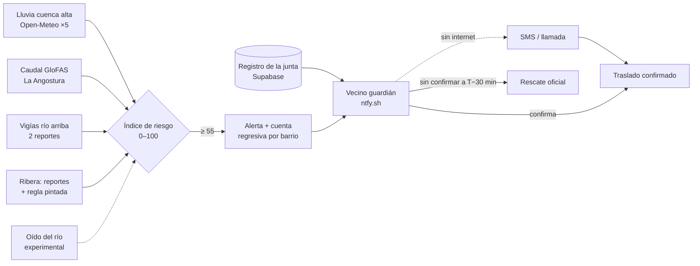

<p align="center"></p>

# El Río Suena #

> **Cuando el río suena, piedras trae.**
>
> Sistema de alerta temprana de crecidas para la ribera del río Piraí (Santa Cruz, Bolivia). Informa a cada barrio cuánto tiempo falta para la llegada del agua y asigna a cada persona que no puede evacuar por sí misma un vecino responsable de su traslado. Utiliza datos abiertos, reportes de vigías ubicados río arriba y teléfonos celulares existentes, y funciona sin conexión a internet.

<p align="center">
  <a href="https://neckhurtttt.github.io/el-rio-suena/?jurado"></a>
  
  
  
</p>
<p align="center">
  
  
  
  
  
  
</p>
<p align="center"><b>Español</b> · <a href="#english">English</a> · <a href="#中文">中文</a> · <a href="pitch-el-rio-suena.md">Guion del pitch</a> · <a href="El%20R%C3%ADo%20Suena%20%C2%B7%20Pitch.pptx">Presentación</a></p>


**Demostración en vivo:** https://neckhurtttt.github.io/el-rio-suena/?jurado. Presione **Iniciar simulacro**; en el modo `?jurado` el tiempo transcurre 300 veces más rápido.
**Teléfono del guardián:** el botón **Sé guardián** muestra un código QR que puede escanearse con cualquier celular, incluso desde una videollamada.

Proyecto presentado en Abstracthon 2026 por el equipo **Birria TECH**, en el track **Ayuda Tecnológica**, que requiere combinar dos o más tracks:

- **Comunicación:** transforma la manera en que un barrio ribereño se informa, se conecta y se coordina, mediante la cuenta regresiva por barrio, los reportes de vecinos y la confirmación del vecino guardián.
- **Educación:** enseña a interpretar el riesgo con la regla pintada (lectura en tres toques), la simulación del nivel del agua sobre la pared de la vivienda y un índice de 0 a 100 explicado en lenguaje sencillo.

**Video de respaldo (sin conexión, 1 min 45 s, con subtítulos):** [capturas/demo-respaldo.mp4](capturas/demo-respaldo.mp4). Muestra el código QR para guardianes, el registro compartido de la junta, el simulacro con las respuestas en tiempo real y la validación con la riada de 2025. También está disponible en la [publicación v1.0-abstracthon](https://github.com/NeckHurtttt/el-rio-suena/releases/tag/v1.0-abstracthon).

---

## Problema

En la madrugada del **13 de diciembre de 2025**, el río Piraí se desbordó en el municipio de **El Torno**. El alcalde informó posteriormente **26 fallecidos oficiales y al menos 1.300 familias damnificadas en 18 comunidades** ([El Deber vía eju.tv](https://eju.tv/?p=4852511)); la Gobernación declaró **desastre departamental**. Fue la riada de mayor magnitud en 42 años, desde el turbión de 1983 ([El Deber](https://eldeber.com.bo/santa-cruz/declaran-desastre-riada-historica-pirai-deja-20-muertos_1765881778), [Wikipedia](https://es.wikipedia.org/wiki/Turbi%C3%B3n_del_r%C3%ADo_Pira%C3%AD_de_1983)). El problema no se limita al Piraí: en la temporada 2024-2025, las lluvias afectaron a **más de 186.000 familias en Bolivia** y causaron 42 fallecimientos ([El País](https://elpais.bo/nacional/20250313_registran-42-fallecidos-por-las-lluvias-en-bolivia.html)). Ante el fenómeno de El Niño 2026-2027, el riesgo de repetición es alto.

En la actualidad:

- Las alertas se emiten **por colores y para todo el departamento**; ninguna indica a una zona concreta **cuánto tiempo dispone para evacuar**.
- Una parte de las familias **no evacúa porque no considera probable** que el agua alcance su vivienda.
- Las personas adultas mayores, con discapacidad física o auditiva y los niños que permanecen solos dependen de que **alguien recuerde acudir por ellos**.

### Evidencia del problema

Los testimonios publicados tras la riada confirman que la población no contó con tiempo de aviso:

> «El río nos sorprendió bastante, todo fue muy rápido. Tuvimos que subir como pudimos.»
> «Primero entró el agua, no pensamos que iba a ser así.»
> «Llegó el agua y nos subimos al techo.»
>
> — Vecinos y trabajadores de los distritos 6 y 7 de El Torno, 13/12/2025 ([El Deber vía eju.tv](https://eju.tv/?p=4841284))

En esa misma jornada, el Servicio Departamental de Salud informó **más de 20 personas rescatadas de los techos y más de 100 evacuadas**, y el colapso de dos puentes dejó comunidades aisladas (misma fuente).

El riesgo es recurrente: el **27 de marzo de 2026**, lluvias nocturnas volvieron a inundar El Torno; la corriente arrastró vehículos en la avenida principal y los vecinos *«expresaron su preocupación por la reiteración de estos eventos»* ([Los Tiempos/ABI](https://www.lostiempos.com/actualidad/pais/20260328/torno-sufre-nuevas-inundaciones-intensa-lluvia-santa-cruz)).

**Contexto nacional.** Entre 2014 y 2024, las inundaciones representaron el **40 % de los eventos adversos registrados en Bolivia** (4.280 incidentes), afectaron a **627.812 familias** y destruyeron más de 12.000 viviendas. En la temporada de 2025, las crecidas afectaron a más de 948.000 familias en 305 municipios, según datos del Viceministerio de Defensa Civil citados por Practical Action ([Brief de impacto: Programa para la Resiliencia ante Inundaciones, Bolivia 2021-2024](https://infohub.practicalaction.org/), Practical Action, 2025; [Estudio de caso: SAT Asunción del Quiquibey](https://infohub.practicalaction.org/), Practical Action, 2025).

**Respaldo al enfoque comunitario.** Los mismos estudios, realizados con más de 6.330 habitantes de 13 comunidades bolivianas en coordinación con el VIDECI y el SENAMHI, concluyen que:

- El **capital social de las comunidades es sólido**, aunque el financiero sea limitado, y se requieren **sistemas de alerta temprana centrados en las personas**. El vecino guardián de El Río Suena se apoya precisamente en ese capital social.
- En la comunidad de Asunción del Quiquibey (Beni), las alertas se recibieron **por WhatsApp** y se difundieron internamente por una red de altavoces, porque *«los procesos comunicacionales propios de la comunidad siguen siendo interpersonales»*. Durante las inundaciones de 2025, ese sistema permitió acciones preventivas.
- Practical Action probó con éxito **tecnologías de código abierto y bajo costo que complementan el sistema de alerta oficial** del SENAMHI, el mismo principio que sigue este proyecto.

No se identificaron encuestas públicas sobre percepción del riesgo o recepción de alertas específicas para la cuenca del Piraí; una encuesta en la ribera forma parte del plan del piloto.

## Público objetivo

| Destinatario | Beneficio |
|---|---|
| **Familias de la ribera** (El Torno, Jorochito, Porongo, Urubó, Portachuelo) | Una cuenta regresiva específica para su barrio y la visualización del nivel del agua sobre su propia vivienda |
| **Personas que no pueden evacuar por sí mismas**: adultos mayores, personas en silla de ruedas o con discapacidad auditiva, niños solos, hablantes de quechua | Un **vecino guardián** asignado; si no se confirma su traslado a tiempo, el caso se deriva al rescate oficial |
| **Guardianes** (vecinos voluntarios) | Un aviso que suena con la pantalla apagada y se confirma con un solo toque, con respaldo por SMS o llamada si no hay internet |
| **Vigías río arriba** (Bermejo, río Espejos) | Un reporte de dos toques para indicar que el río creció; observan lo que los satélites no detectan |
| **Instituciones que lo adoptan**: junta vecinal, Unidad de Gestión de Riesgos municipal, COED de la Gobernación, SEARPI | Un **panel en tiempo real** con el estado de cada persona, exportable a CSV o imprimible |

## Solución

| Componente | Función |
|---|---|
| **Vigía del Piraí** | Cada diez minutos consulta la precipitación en cinco puntos de la cuenca alta (Open-Meteo), el caudal GloFAS en La Angostura y los reportes de **vigías río arriba**, y calcula un **índice de riesgo de 0 a 100**. Cualquiera de las tres fuentes puede activar la alerta; dos reportes de vigías son suficientes. |
| **Cuenta regresiva por barrio** | Calcula la distancia sobre el cauce real del río (OpenStreetMap) y muestra avisos como «el agua llega a El Torno en **2 h 20 min**». |
| **El agua en su pared** | Con la cámara del teléfono, dibuja sobre la vivienda la altura que alcanzaría el agua. Sin cámara, la muestra sobre una pared ilustrada. |
| **Vecino guardián** | Cada persona vulnerable tiene un vecino asignado. Ante una alerta, el teléfono del guardián suena y vibra, y este confirma el traslado con un toque. **Si no hay confirmación 30 minutos antes de la llegada del agua, el caso se deriva al rescate oficial.** |
| **Registro compartido** | La junta vecinal registra, aprueba y supervisa a las personas desde cualquier dispositivo, con acceso protegido por clave (ver *Backend*). |

**Complemento experimental:** el *oído del río*, un teléfono ubicado junto a la orilla que analiza el sonido grave del caudal (20–300 Hz).

### Fundamento: la ventaja de 2 h 30 min

La lluvia que cae en la cuenca alta (Samaipata, Bermejo, Cuevas) tarda aproximadamente **2 h 30 min** en llegar a La Angostura. Al observar **dónde llueve** y no únicamente dónde ya creció el río, se obtiene ese tiempo para la evacuación.

## Validación con la riada del 13 de diciembre de 2025

Antes de adoptar el índice, se evaluó su comportamiento con los datos de la noche del desastre ([`herramientas/validar.py`](herramientas/validar.py); en la aplicación, botón **«¿Habría avisado la riada real?»**):

| Fuente abierta | Registro en la cuenca alta del Piraí, 12/12 06:00 a 13/12 07:00 |
|---|---|
| Open-Meteo best_match | 20 mm en total, máximo 3 mm/h |
| ECMWF IFS | 26 mm, máximo 2 mm/h |
| DWD ICON | 1 mm |
| NOAA GFS | 18 mm, máximo 3 mm/h |
| Caudal GloFAS en La Angostura | **sin aumento** (12 → 12 → 12 m³/s) |


**Ningún modelo global registró la tormenta local del Amboró.** Con datos abiertos únicamente, el índice no supera **2/100**; es decir, el sistema **no habría emitido la alerta**. Este resultado modificó el diseño:

- **Dos vigías río arriba** (Bermejo, río Espejos) que reporten el crecimiento del río **activan la alerta por sí solos**. Con el modelo de la aplicación (crecida rápida, escenario conservador), ello habría otorgado **aproximadamente 4 horas de anticipación** antes del desborde en El Torno. *La hora del reporte es hipotética, ya que se desconoce cuándo lo habría observado un vecino.*
- El umbral de caudal se ajustó con **42 años de datos GloFAS** (1984–2026: mediana de 11 m³/s, percentil 95 de 35 m³/s). El período anterior (2024–2026, percentil 95 de 17) generaba falsas alarmas.
- **Conclusión:** los modelos globales son útiles para tormentas de gran escala; las tormentas locales del Amboró las detectan **las personas**. Por ello el sistema combina datos abiertos, vigías, reglas pintadas y el oído del río.

## Diferenciación

| | Aviso **por barrio con minutos** | Detecta tormentas **locales** | Asiste a **quien no puede evacuar** | Funciona **sin internet** | Costo para la familia |
|---|:---:|:---:|:---:|:---:|:---:|
| Alerta oficial por colores (departamental) | No | Depende de estaciones | No | Radio y televisión | 0 |
| Pronósticos globales de crecidas (GloFAS, Google Flood Hub) | No (por tramo de río) | No (ver validación) | No | No | 0 |
| Grupos de WhatsApp del barrio | Ocasionalmente | Solo si alguien avisa | Solo si alguien lo recuerda | No | 0 |
| Sirenas | No | No | No (no llegan a personas sordas) | Sí | Alto (instalación) |
| **El Río Suena** | **Sí** | **Sí** (vigías, regla, oído) | **Sí** (guardián y derivación a T−30) | **Sí** (aplicación instalada y SMS) | **0** |

## Justificación tecnológica

| Tecnología | Motivo |
|---|---|
| **Aplicación web progresiva** (GitHub Pages, service worker) | Se abre con un enlace o código QR, se instala sin tienda de aplicaciones y **funciona sin internet**. No depende de un servidor que pueda fallar durante la crecida. |
| **Open-Meteo** (precipitación) y **GloFAS** (caudal) | Gratuitos, sin clave de acceso y con registro histórico para la validación. Adecuados para tormentas de gran escala. |
| **Vigías y regla pintada** | Cubren lo que los modelos no detectan (riada de 2025). Requieren únicamente un teléfono básico y pintura. |
| **ntfy** (notificaciones abiertas) | Suena con la pantalla apagada y no exige crear cuentas. Puede instalarse en un servidor propio del municipio. |
| **Supabase** (PostgreSQL) | Registro compartido de la junta vecinal sin servidor que mantener; acceso exclusivamente mediante funciones validadas y clave de la junta. |
| **SMS y llamada** | Respaldo ante la caída de internet; utilizan el plan del teléfono. |
| **MapLibre y OpenStreetMap** | Mapa abierto con el cauce real del Piraí; las zonas consultadas quedan almacenadas para su uso sin conexión. |
| **Web Audio y cámara** | El oído del río y la simulación sobre la pared se procesan en el propio teléfono, sin transmitir audio ni video. |

## Implementación

| Fase | Alcance | Responsables | Costo estimado |
|---|---|---|---|
| **0. Actual** | Prototipo funcional, validado con la riada de 2025 y probado en teléfonos reales | Birria TECH | 0 |
| **1. Piloto** (temporada de lluvias, diciembre a marzo) | El Torno: una junta vecinal, **10 vigías** río arriba, **5 reglas pintadas** en puentes, alrededor de 50 personas registradas y servidor ntfy propio. Calibración de tiempos y alturas con SEARPI y el COED | Junta vecinal, UGR de El Torno, SEARPI | Aproximadamente Bs 1.500 (pintura, servidor por cuatro meses, capacitación) |
| **2. Cuenca del Piraí** | Porongo, ribera de Santa Cruz, Urubó y Portachuelo; panel para el COED | Gobernación (COED) | Suscripción por tramo de río |
| **3. Alcance nacional** | Río Grande, Mamoré (Beni), Rocha (Cochabamba) y ríos de La Paz: únicamente se modifican el cauce, los puntos de la cuenca y los barrios | Municipios y Viceministerio de Defensa Civil | Equivalente por tramo |

**El servicio es gratuito para las familias.** Los costos son estimaciones del equipo y no constituyen cotizaciones.

**Gestiones institucionales:** el 21 de noviembre de 2026 se remitió una nota formal a la Gobernación de Santa Cruz (COED y Dirección de Gestión de Riesgos, con pedido de derivación al SEARPI) y al Gobierno Autónomo Municipal de El Torno, solicitando una reunión para calibrar el sistema y evaluar el piloto. Texto completo y estado: [`docs/carta-instituciones.md`](docs/carta-instituciones.md).

### Aplicabilidad nacional

- **Ningún componente es exclusivo del Piraí:** el cauce, los cinco puntos de precipitación, los barrios y el tiempo de tránsito del agua son **datos de configuración** (`js/datos.js`). Para otro río basta con modificar esos datos; la aplicación, los guardianes y el panel se mantienen.
- **Los datos abiertos cubren todo el territorio boliviano:** Open-Meteo y GloFAS tienen cobertura mundial, sin convenios ni sensores.
- **La red humana ya existe en todo el país:** juntas vecinales, OTB y Unidades de Gestión de Riesgos municipales. El Río Suena les proporciona una herramienta; no crea una estructura nueva.
- **Costo marginal reducido:** cada río adicional requiere una configuración y un piloto de aproximadamente Bs 1.500; el servidor de avisos es compartido.

### Backend: registro compartido de la junta vecinal (Supabase)

- Una persona registrada desde **cualquier teléfono** se incorpora al registro compartido de su comunidad y aparece en el panel de la junta en **aproximadamente 1,3 segundos** (aviso inmediato por ntfy y actualización periódica cada 30 segundos).
- La junta accede al panel con su **clave** (demostración: comunidad `demo`, clave `1312`), aprueba a cada persona y, desde ese momento, esta recibe las alertas. Cada persona aprobada dispone de su propio **código QR de guardián**.
- **Privacidad:** las tablas no pueden leerse con la clave pública (seguridad a nivel de fila sin políticas de acceso). Todas las operaciones se realizan mediante funciones (`rs_registrar`, `rs_listar`, `rs_aprobar`, `rs_quitar`) que validan los datos y exigen la clave de la junta para consultar o aprobar. La clave se almacena cifrada con bcrypt.
- **Sin conexión**, el registro se guarda en el teléfono y se envía automáticamente al restablecerse la conexión; la central conserva la última copia disponible.
- Esquema completo: [`supabase/esquema.sql`](supabase/esquema.sql). Prueba integral realizada: registro en un teléfono, aparición en la central en 1,3 s, aprobación, código QR del guardián, alerta y confirmación de vuelta en 3 segundos.

## Impacto y medición

- **Tiempo de anticipación:** aproximadamente 4 horas antes del desborde de 2025 con vigías (estimación con hora de reporte hipotética); 2 h 30 min cuando los modelos registran la lluvia.
- **Cobertura:** porcentaje de personas registradas cuyo traslado se confirma antes de la llegada del agua (meta del piloto: 100 %; los casos restantes se derivan al rescate a T−30 min).
- **Margen:** minutos promedio entre la confirmación y la llegada del agua, calculados en la pantalla de cierre del simulacro.
- **Tiempo de respuesta del guardián:** la central lo registra en tiempo real. En la prueba del 21 de noviembre de 2026, dos teléfonos reales (Android e iPhone) recibieron la alerta y confirmaron el traslado.
- **Falsas alarmas:** alertas emitidas sin crecida por temporada, a registrar durante el piloto con SEARPI.
- **Escala:** solo en El Torno hubo al menos 1.300 familias damnificadas en 2025; el piloto registrará a las personas que no pueden evacuar por sí mismas en una comunidad y luego se extenderá a las 18.
- **Costo para la familia:** Bs 0.

## Guion de demostración (un minuto)

1. Abrir `?jurado` y presionar **Iniciar simulacro**: se simula una tormenta en la cuenca alta.
2. El índice supera 55, se emite la **alerta** y cada barrio muestra su cuenta regresiva.
3. El teléfono del guardián (código QR **Sé guardián**) suena; el guardián presiona **«Ya la ayudé»** y la central muestra el tiempo de respuesta.
4. Cuando todos los guardianes confirman, aparece la pantalla de cierre con las personas trasladadas, el margen y el costo.
5. **«¿Habría avisado la riada real del 13/12/2025?»** muestra la gráfica de esa noche, hora por hora.
6. **Panel de la junta**: se ingresa la clave `1312`; las personas registradas desde otro teléfono aparecen en vivo y pueden aprobarse o exportarse a CSV.
7. Sin conexión, la aplicación instalada sigue abriendo y desde cada persona se puede enviar un SMS o llamar al guardián.

| Teléfono del guardián | Nivel del agua sobre la vivienda |
|:---:|:---:|
|  |  |

<details><summary>Capturas fijas</summary>

| Registro compartido de la junta | Alerta |
|---|---|
|  |  |
| **Respuestas de los guardianes** | **Cierre del simulacro** |
|  |  |
</details>

## Arquitectura



- **Interfaz:** aplicación web estática publicada en GitHub Pages, compatible con cualquier teléfono.
- **Mapa:** MapLibre y OpenFreeMap, con el cauce real del Piraí obtenido de OpenStreetMap.
- **Índice:** función `indiceRiesgo` en `js/datos.js`. Tres fuentes pueden activar la alerta: precipitación, caudal y **dos vigías río arriba**. Los reportes de la ribera por sí solos **no** activan la alerta; únicamente colocan la zona en vigilancia, para evitar falsas alarmas.
- **Audio:** Web Audio con una FFT de 4096 muestras; compara la energía entre 20 y 300 Hz con la línea base y señala un aumento sostenido durante 1,5 segundos.
- **Canal con los guardianes:** ntfy.sh (publicación y suscripción, compatible con la aplicación ntfy), con BroadcastChannel como respaldo local.
- **Registro compartido:** `js/nube.js` y `js/registro.js` con Supabase; funciones RPC definidas en `supabase/esquema.sql`.
- **Funcionamiento sin conexión:** `sw.js` almacena la aplicación, la última consulta de datos y el mapa visitado; los guardianes cuentan con SMS y llamada de respaldo.
- **Accesibilidad:** botón **Aa** (letra grande y alto contraste) y lectura del aviso en voz alta.

## Estructura del repositorio

```
index.html             aplicación principal (mapa, índice, alerta, pared)
guardian.html          pantalla del teléfono del guardián
js/datos.js            barrios, personas de ejemplo, índice de riesgo
js/lluvia.js           Vigía: Open-Meteo (precipitación) y GloFAS (caudal)
js/mapa.js             MapLibre y cuenta regresiva sobre el cauce
js/cauce-pirai.js      cauce del Piraí (OpenStreetMap)
js/oido.js             oído del río (micrófono)
js/pared.js            simulación del agua sobre la pared (cámara)
js/canal.js            ntfy.sh y BroadcastChannel
js/registro.js         registro de personas, aprobación y CSV
js/nube.js             conexión con el registro compartido (Supabase)
js/historico.js        riada del 12–13/12/2025 (datos abiertos)
supabase/esquema.sql   tablas y funciones del registro compartido
sw.js                  funcionamiento sin conexión (PWA)
herramientas/validar.py  reproduce la validación con Open-Meteo
pruebas.mjs            pruebas automatizadas
```

## Ejecución local

```bash
python3 -m http.server 8765      # http://localhost:8765/?jurado
node pruebas.mjs                 # pruebas automatizadas
python3 herramientas/validar.py  # riada de 2025 y 42 años de GloFAS
```

- La cámara y el micrófono requieren HTTPS o `localhost`.
- El parámetro `?x=60` modifica la aceleración del tiempo (por defecto ×300 en `?jurado`).
- Para otra comunidad o junta: parámetro `?c=<comunidad>` y una fila nueva en `rs_juntas`.

## Próximos pasos

- [ ] Calibrar tiempos y alturas con **SEARPI** y el **COED**.
- [x] Probar el canal de avisos con dos teléfonos reales (realizado el 21/11/2026).
- [x] Registro compartido de la junta vecinal con base de datos (Supabase).
- [x] Funcionamiento sin conexión con respaldo por SMS y llamada.
- [ ] Instalar un servidor ntfy propio para el piloto.
- [ ] Avisos en **video en Lengua de Señas Boliviana** y audios en **quechua y guaraní** grabados por hablantes.
- [ ] Conformar la red de vigías río arriba con la junta (Bermejo, río Espejos) y probarla en temporada de lluvias.
- [ ] Incorporar precipitación satelital de alta resolución (GPM IMERG) para tormentas locales.

## Limitaciones

- Las distancias, velocidades y alturas son **estimaciones** hasta su calibración con datos oficiales.
- Con datos abiertos únicamente, el sistema **no habría alertado** la riada del 13/12/2025 (ver *Validación*). La anticipación de aproximadamente 4 horas con vigías es una estimación basada en una hora de reporte hipotética.
- El sistema **complementa** a las estaciones oficiales; no las reemplaza. La detección acústica es un prototipo, si bien el monitoreo acústico de crecidas es objeto de investigación.
- Las personas de la demostración son ficticias. El tema público de ntfy y la clave `1312` se utilizan únicamente con fines de demostración.

## Equipo Birria TECH

Sergio (desarrollo) · José Miguel Salinas (pitch, documentación y depuración) · Rodrigo Camacho (pruebas) · Deron Zuñiga (programación)

**Licencia:** [MIT](LICENSE) · **Datos:** Open-Meteo (pronóstico y Flood API/GloFAS) · © colaboradores de OpenStreetMap · OpenFreeMap.

---

## English
**When the river roars, it brings stones.** Early flood warning for the Piraí river (Santa Cruz, Bolivia), neighborhood by neighborhood, for people who cannot evacuate alone. No dedicated hardware is required.

- **Piraí Watch:** every 10 min it reads open data: rain at 5 upper-basin points (Open-Meteo), GloFAS discharge at La Angostura and neighbor reports. With that it computes a **0–100 risk index**. Rain in the upper basin takes about **2 h 30 min** to reach La Angostura, and that is the head start for evacuating.
- **Countdown per neighborhood**, measured along the real river channel: *"water reaches El Torno in 2 h 20 min"*.
- **Water on your wall:** point the camera at your house and see how high the water would rise.
- **Neighbor Guardian:** the guardian's phone rings and vibrates, and they confirm with one tap. If nobody confirms 30 min before the water arrives, the case goes to official rescue.
- **Optional extra:** a phone that *listens* to the river's low rumble (20–300 Hz).

**Validated against the real flood of 13 Dec 2025** (El Torno: 26 dead, 1,300+ families affected in 18 communities): no open model saw the local Amboró storm (≤ 26 mm, GloFAS flat), so open data alone would **not** have warned. Now **2 upstream watchers** trigger the alert alone, which would have given ~4 h of warning (hypothetical report time). Works **offline** (PWA) with SMS/call fallback, has a **neighborhood-board panel** (CSV/print), registration with approval, and a large-text/high-contrast mode.

- **Backend (Supabase):** a person registered from **any phone** shows up on the board's panel in **~1.3 s**. The board signs in with its key (demo: community `demo`, key `1312`), approves people, and gets a **guardian QR code** for each one. The tables cannot be read with the public key: everything goes through RPC functions that validate the data and require the board's key. Offline sign-ups are queued and sent later. Schema: `supabase/esquema.sql`.
- **Tested on real phones (21 Nov 2026):** an Android and an iPhone got the alert with a siren and replied "safe". The central shows the real response time live ("safe · 0:03 after the alert"). Judges can join from the video call by scanning the **«Sé guardián»** QR code.
- **Nationwide:** rain affected **186,000+ families in Bolivia** in the 2024-25 season. The river, basin points and neighborhoods are configuration, so the same app works for the Mamoré (Beni), the Rocha (Cochabamba) or the rivers of La Paz. Open-Meteo and GloFAS cover the whole country, and every municipality already has neighborhood boards. Each new river is a pilot of about Bs 1,500.

Tracks: **Technology Aid** = **Communication** (neighborhood alerts, reports, guardians) + **Education** (painted gauge, water on your wall, plain-language risk index). Backup video: `capturas/demo-respaldo.mp4`. License: MIT.

Demo: open `?jurado` → **Iniciar simulacro**. Run locally: `python3 -m http.server 8765`, tests: `node pruebas.mjs`. Distances and heights are estimates until they are calibrated with SEARPI/COED. This complements official stations; it does not replace them.

## 中文
**河水作响，必有石来。** 面向玻利维亚圣克鲁斯皮拉伊河沿岸的洪水预警系统：按社区倒计时，为无法独自撤离的人安排邻居守护者，无需任何硬件。

- **皮拉伊河守望**：每 10 分钟读取开放数据，包括上游流域 5 个点的降雨量（Open-Meteo）、La Angostura 的 GloFAS 流量和邻居上报，计算 **0–100 风险指数**。上游降雨约 **2 小时 30 分钟** 后到达 La Angostura，这就是争取到的撤离时间。
- **按社区倒计时**：沿真实河道计算，例如「洪水 2 小时 20 分钟后到达 El Torno」。
- **墙上的水位**：用手机摄像头对准自家墙面，显示水会涨到多高。
- **邻居守护者**：守护者的手机响铃并震动，一键确认；若洪水到达前 30 分钟仍无人确认，则转交官方救援。

**已用 2025 年 12 月 13 日真实洪灾验证**（El Torno：26 人遇难，18 个社区逾 1,300 户受灾）：开放模型都没有捕捉到 Amboró 局地暴雨，仅靠开放数据**无法**预警；因此现在 **2 名上游观察员** 即可单独触发警报（约提前 4 小时，报告时间为假设）。支持**离线**（PWA）与短信/电话备份、社区委员会面板（CSV/打印）、登记审批及大字高对比模式。

- **后端（Supabase）**：在**任意手机**上登记的人约 **1.3 秒** 后出现在社区委员会面板上。委员会用密钥登录（演示：社区 `demo`，密钥 `1312`），审批后为每个人生成**守护者二维码**。公开密钥无法直接读取数据表，所有操作都通过校验数据并要求委员会密钥的 RPC 函数完成；离线登记会排队，联网后自动上传。数据库结构：`supabase/esquema.sql`。
- **真机测试（2026 年 11 月 21 日）**：一部安卓手机和一部 iPhone 收到带警报声的预警并回复「安全」；中心实时显示真实响应时间（「安全 · 预警后 0:03」）。评委在视频会议中扫描 **«Sé guardián»** 二维码即可加入。
- **全国适用**：2024-25 雨季，玻利维亚有**超过 18.6 万户**家庭受灾。河道、流域观测点和社区都只是配置，同一套系统可用于 Mamoré（贝尼）、Rocha（科恰班巴）或拉巴斯的河流；Open-Meteo 与 GloFAS 覆盖全国，各市已有社区委员会。每条新河流的试点成本约 1,500 玻利维亚诺。

赛道：**科技助力** = **沟通**（社区预警、邻居上报、守护者）+ **教育**（水尺读数、墙上水位、通俗风险指数）。备用视频：`capturas/demo-respaldo.mp4`。许可证：MIT。

演示：打开 `?jurado` → 点击 **Iniciar simulacro**。本地运行：`python3 -m http.server 8765`，测试：`node pruebas.mjs`。距离与水位均为估算，需要与 SEARPI/COED 校准；本系统是官方监测站的补充，不能替代它们。

